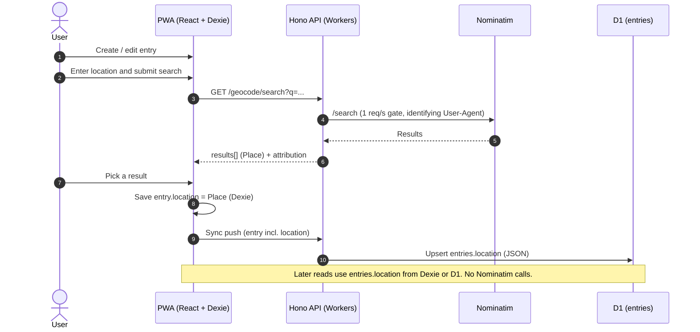

# Entry location storage

## Decision

When a user sets a location on an entry, they search through our own API (which proxies Nominatim), pick a result, and that result is stored **as a JSON column on the entry**, in both Dexie (frontend) and D1 (backend). Everything that needs the location later reads that column. Nominatim is only queried when the user is actively choosing or changing a location.

## Flow



## Data shape

`entries.location` is a nullable JSON column holding one `Place` (the same shape the search endpoint returns):

```ts
type Place = {
  osmType: string | null;
  osmId: number | null;
  displayName: string;
  name: string | null;
  lat: number;
  lng: number;
  category: string | null;
  type: string | null;
  locality: string | null;
  country: string | null;
  countryCode: string | null;
  boundingBox: [south: number, north: number, west: number, east: number] | null;
};
```

| Layer | Definition |
| --- | --- |
| D1 (Drizzle) | `location: text('location', { mode: 'json' }).$type<Place>()` (nullable) |
| Dexie | plain `location?: Place` property on the entry, no index needed unless filtering (e.g. `location.countryCode`) |
| Sync | add `location` (nullable `PlaceSchema`) to the push and pull zod schemas |

## Rules

- **Search endpoint is read-only.** It never writes to the DB. Persistence happens through the normal write flow (Dexie, sync queue, D1) with last-write-wins on the entry's `updatedAt`.
- **Search only on explicit submit.** No search-as-you-type (forbidden by the Nominatim policy).
- **Changing a location** re-runs search and overwrites `location` as part of the entry edit.
- **Offline:** an entry can be saved without a location and have one added later when online.
- **Attribution:** show "© OpenStreetMap contributors" wherever location data or the map is displayed.
- **Throttle stays:** the Durable Object gate keeps the whole app under 1 req/s. A KV cache for repeat searches is optional. The `geocode_cache` table is no longer needed.

## Schema changes

- **Drop the `lat` and `lng` columns from `entries`** (D1 and Dexie), and remove them from the push and pull zod schemas. Coordinates now live only in `location.lat` and `location.lng`, so there is a single source of truth.
- **Map pins** are placed from `entries.location`. Entries with no location get no pin.
- **No reverse geocoding.** Nothing in the app needs it, so the `/reverse` endpoint isn't required.
- **Before dropping the columns,** check whether any existing entries have coordinates but no `location`. Those entries would lose their pin.
